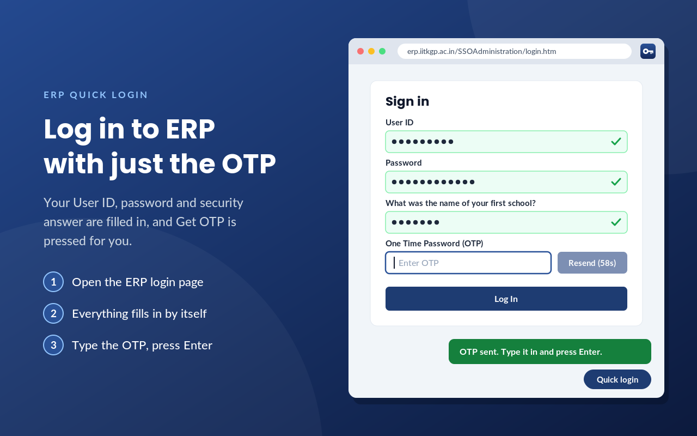
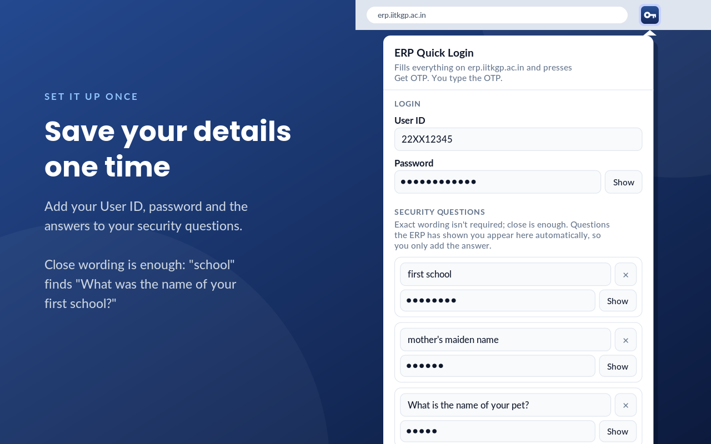
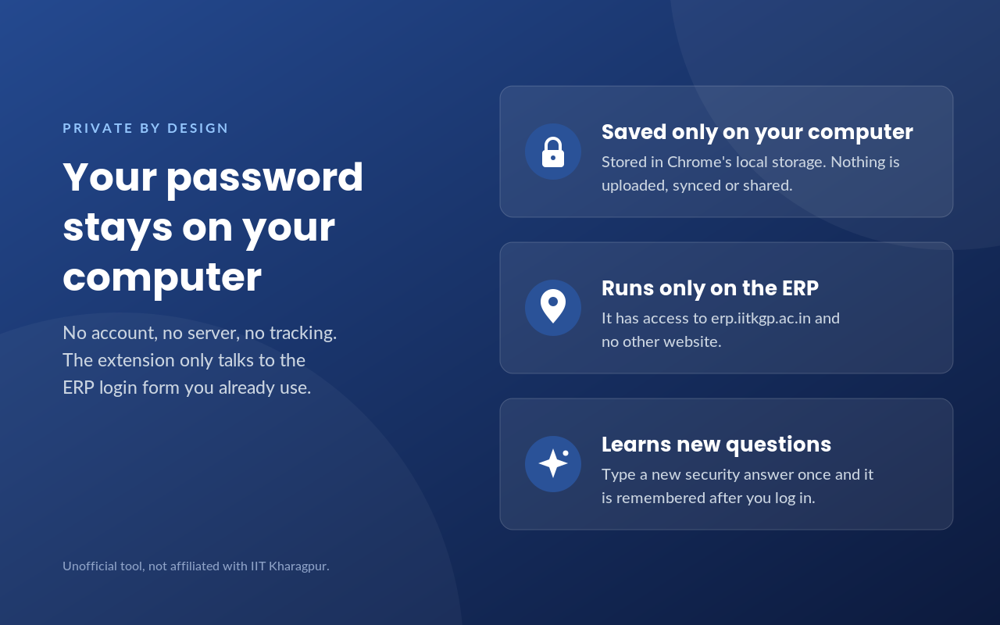

# ERP Quick Login — for IIT Kharagpur students

Unofficial Chrome / Edge extension that makes logging in to the IIT KGP ERP (`erp.iitkgp.ac.in`) one click.

It fills your **User ID + password + security answer** and presses **Get OTP** for you. You only type the OTP from your email and hit Enter.

> Unofficial tool. Not affiliated with or endorsed by IIT Kharagpur.

---

## Demo

| Login page | Setup | Privacy |
|---|---|---|
|  |  |  |

---

## Features

- Auto-fills User ID, password and the matching security answer.
- Fuzzy matching — `"school"` matches `"What was the name of your first school?"`.
- Auto-presses **Get OTP**, closes the “OTP Sent!” popup, focuses the OTP box.
- **Enter in the OTP box = Log In.**
- Learns new questions — type the answer once, it's remembered after a successful login.
- Floating **Quick login** button on the ERP page to re-run anytime.
- Every automation step can be turned off in settings.
- 100% local — no servers, no analytics, no tracking. See [`store-assets/privacy-policy.md`](store-assets/privacy-policy.md).

---

## Install in 2 minutes (no coding needed)

Works on **Google Chrome, Microsoft Edge, Brave, Arc** — any Chromium browser — on Windows / Mac / Linux.

### Option A: Load the folder (easiest, recommended)

1. **Download this repo:** click **Code → Download ZIP** on GitHub, extract it anywhere.  
   Or with git:
   ```bash
   git clone https://github.com/madhavKGP/ERP-Login-.git
   ```
2. Open your browser and go to:
   - Chrome / Brave: `chrome://extensions`
   - Edge: `edge://extensions`
3. Turn **ON** `Developer mode` (toggle in the top-right corner).
4. Click **Load unpacked**.
5. Select the **`erp-quick-login`** folder inside this repo (the one containing `manifest.json`).
6. Done. Pin it: click the puzzle 🧩 icon in the toolbar → pin **ERP Quick Login**.

### Option B: Install from the zip

1. Download `store-assets/erp-quick-login.zip` from this repo.
2. Extract it to a folder.
3. Follow steps 2–6 from Option A with the extracted folder.

> Updating later? `git pull` (or re-download the ZIP), then go to `chrome://extensions` → click **Reload** ⟳ on ERP Quick Login.

---

## One-time setup (1 minute)

1. Open <https://erp.iitkgp.ac.in>.
2. Click the **ERP Quick Login** icon in the toolbar.
3. Fill in:
   - **User ID** — your roll number (e.g. `23CS10001`).
   - **Password** — your ERP password.
   - **Security questions** — add each question + answer. Exact wording isn't needed, close is enough.
     > Tip: if the ERP has already shown you a question, it appears automatically in the popup — you just type the answer.
4. Leave all three checkboxes ON (recommended):
   - ☑ Fill automatically when the login page opens
   - ☑ Press Get OTP after filling
   - ☑ Close the "OTP Sent" dialog and jump to the OTP box
5. Click **Save**.


---

## Daily use

1. Go to <https://erp.iitkgp.ac.in>.
2. Everything fills itself and **Get OTP** is pressed.
3. Check your email for the OTP, type it in, press **Enter**. Done.

If anything didn't run, click the floating **Quick login** button (bottom-right) or open the extension popup → **Fill this tab**.

---

## Privacy & safety — read this

- Your User ID, password and answers are stored **only in your browser on this computer** (`chrome.storage.local`). Nothing is uploaded anywhere. The extension makes zero network requests of its own.
- Full policy: [`store-assets/privacy-policy.md`](store-assets/privacy-policy.md).
- ⚠️ **Do NOT install this on a shared / cyber-café / lab PC.** Anyone with access to that browser could read your saved password.
- You still type the OTP yourself, so ERP's two-step login stays intact.
- If you lose your laptop, change your ERP password immediately.

To wipe your data: clear the fields in the popup → **Save**, or just remove the extension (removing deletes everything it stored).

---

## FAQ

**Does it bypass the OTP?**  
No. It only fills what you'd type anyway. You always type the OTP yourself.

**Security question not filled?**  
Type the answer yourself that one time and log in normally — the extension remembers it from next time. Fuzzy matching handles small wording differences.

**"The security question didn't load"?**  
Your saved User ID is probably wrong. Fix it in the popup and click **Fill this tab**.

**Get OTP cooling down?**  
The ERP rate-limits OTPs. Wait for the timer on the page, then press Get OTP manually.

**Does it work on other sites?**  
No. It runs only on `erp.iitkgp.ac.in`.

**Chrome Web Store?**  
Not published yet — sideload via `Load unpacked` above. Store submission kit (listing text + images) is in [`store-assets/`](store-assets/).

---

## For developers

```
.
├── erp-quick-login/      # the extension (load this folder unpacked)
│   ├── manifest.json     # Manifest V3, storage permission, erp.iitkgp.ac.in only
│   ├── match.js          # fuzzy security-question matching (shared)
│   ├── content.js        # fills form, presses Get OTP, toast UI
│   ├── popup.html        # settings UI
│   ├── popup.js          # save/load chrome.storage.local
│   └── icons/            # 16/32/48/128
├── store-assets/         # store listing text, privacy policy, screenshots, promo art, release zip
│   └── erp-quick-login.zip  # ready-to-upload store package (same as extension folder)
```

No build step, no dependencies. Edit the files, go to `chrome://extensions` → **Reload**.

---

## Contributing

PRs welcome — especially better question matching, UI polish, Firefox support. Please don't commit real credentials or personal data.

## License

MIT — see [LICENSE](LICENSE).

## Disclaimer

Unofficial helper built by a student. Not affiliated with, maintained, or endorsed by IIT Kharagpur. Use at your own risk.
